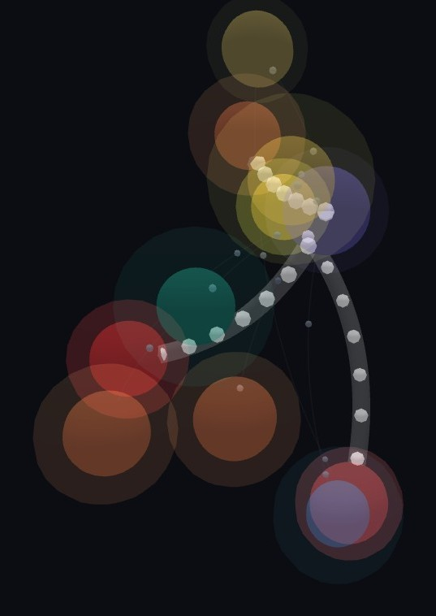

# CLAUDE.md - context for AI agents working on REDNESS

This file is how *both* researchers' Claude instances stay in sync. Read it first,
then `docs/DECISIONS.md` (the why) and `docs/LIVE_GRAPH.md` (the GUI plan).

## What this is
Red-team **orchestrator + normalizer + reporter** for AD/Windows assessments.
It does NOT reimplement protocols - it drives NetExec, Impacket, Certipy, normalizes
their output into one findings model, renders a `.docx` report, and can stream a live
3D graph of the enumeration. Codename REDNESS; will be renamed later.

## The one rule that keeps two agents from colliding
`redness/findings.py` is **the contract**. Engines produce `Finding`s; the reporter
consumes them. Change it only deliberately, bump `SCHEMA_VERSION`, and log it in
`docs/DECISIONS.md`.

## Current status (2026-09-23)
Working, tested (309 tests), builds to a single offline `.exe`. Commands: `demo / report / diff /
live / gui / scan / poison / spray / trigger / coerce / listen / bloodhound / doctor`. Reports
render to `.docx` and a self-contained `.html` (findings + the live 3D graph inlined). Real
findings need `nxc` + `certipy` on PATH; `poison` needs `responder` (Linux/Kali). Capability tiers
in ROADMAP are essentially complete; next focus is GUI/animation polish (docs/GUI.md).



## Layout
```
redness/
  findings.py     # normalized findings model  <-- THE CONTRACT (schema v1.2.0)
  events.py       # EventBus (status/finding/node/edge/probe/done) - live-graph seam
  scan.py         # run_scan(): engines x targets -> Report (+ stream to bus; captures meta["graph"])
  diff.py         # retest diff: baseline vs current findings.json -> new/fixed/unchanged/changed
  audit.py        # unified loot/audit.log (JSONL) across scan/poison/spray/coerce/actions
  graphmodel.py   # collect NODE/EDGE events -> {nodes,links} for the HTML report (+ report fallback)
  discovery.py    # TCP connect-scan -> dispatch only relevant engines (hail-mary); --no-discovery
  scope.py        # parse --targets scope file (IP/host/CIDR per line, # comments)
  paths.py        # derive attack-path edges from findings (owned/roastable/ADCS -> Domain Admin)
  relay.py        # derive NTLM relay chains (coerce + no-signing + ESC8) -> "NTLM Relay" node
  mcast.py        # passive link-local discovery (mDNS/LLMNR/NBT-NS/SSDP); `listen` command
  crack.py        # capture AS-REP/Kerberoast hashes -> loot files -> crack (hashcat/john)
  cli.py          # entrypoint: demo / report / live / scan / poison / spray / trigger / coerce
  spray.py        # gated `spray` command: lockout-aware nxc password spray (intrusive)
  coerce.py       # gated `coerce` command: RPC forced-auth (PetitPotam/PrinterBug/DFSCoerce) via nxc coerce_plus (intrusive)
  engines/        # tool wrappers -> List[Finding]  (Person A)
    base.py       #   Engine ABC + Target + emit_* helpers
    netexec.py    #   nxc SMB: signing, SMBv1, null/guest, shares
    ldap.py       #   nxc LDAP: users + AS-REP/Kerberoast hash capture (meta["hashes"])
    delegation.py #   delegation/RBCD/MAQ/gMSA enum (nxc ldap); MAQ escalates w/ AD CS combo
    certipy.py    #   AD CS ESC1-ESC16 (parses `certipy find -json`)
    tls.py        #   TLS: legacy proto, weak ciphers, cert expiry/self-signed (pure stdlib)
    sharehunt.py  #   share secret-hunting: nxc spider_plus + pure classifier (Category.SECRET)
    gpp.py        #   GPP cpassword: nxc -M gpp_password -> recovered creds (meta["credentials"])
    spray.py      #   password spraying: pure pass-pol/hit parsers + lockout-safety math
    coerce.py     #   coercion: pure coerce_plus parser + coerce_argv + per-vector findings (Category.CONFIG)
    remote.py     #   RDP/WinRM/MSSQL: NLA + exposure + credentialed remote-exec reach (passive)
    ftp.py        #   nxc ftp: anonymous login + exposure/banner
    http_ad.py    #   AD web surfaces (stdlib): /certsrv = ESC8, OWA/EWS, server banner
    snmp.py       #   default SNMP communities via snmpwalk (public=HIGH, private=CRITICAL)
    ics_common.py #   OT/ICS shared: read-only socket probes + exposure/inventory finding builder
    enip.py       #   EtherNet/IP (CIP) List Identity (TCP 44818)  [Category.ICS; opt-in scan --ics]
    modbus.py     #   Modbus/TCP Read Device Identification (TCP 502)  [Category.ICS; opt-in]
    bacnet.py     #   BACnet/IP Who-Is/I-Am (UDP 47808)  [Category.ICS; opt-in]
    dnp3.py       #   DNP3 Request Link Status + outstation addr (TCP 20000)  [Category.ICS; opt-in]
    hartip.py     #   HART-IP Session Initiate presence (TCP 5094)  [Category.ICS; opt-in]
  report/         # List[Finding] -> .docx + self-contained .html (html_report.py)  (Person B)
  live/           # 3D live GUI: SSE bridge + web UI + demo driver  (Person B)
    bridge.py     #   SSE stream + POST /scan (CSRF-token gated) + static serving
    demo.py, web/index.html, web/logo.svg, web/vendor/3d-force-graph.min.js
packaging/        # PyInstaller: entry.py + redness.spec + build.ps1
tests/            # pure-parser / orchestration tests, no DC/tools needed
docs/             # DECISIONS.md, LIVE_GRAPH.md, screenshots/
examples/scope.txt
```

## Ownership seams (work in parallel, avoid merge conflicts)
- **Person A - `redness/engines/`** : tool wrappers that emit `Finding`s. Keep parsing
  pure and separate from subprocess exec (see netexec.py/certipy.py) so it unit-tests.
- **Person B - `redness/report/` + `redness/live/` + packaging.**
Touch the other's directory only via a PR they review.

## Install (git clone -> one command -> `redness`)
`./scripts/install.sh` (Linux/Kali) or `.\scripts\install.ps1` (Windows): makes a venv,
`pip install ".[engines]"` (certipy+impacket via pyproject.toml, console script `redness`),
installs NetExec via pipx if missing, runs `redness doctor`. Kali with `nxc` already on PATH
is the easy operator box.

## Making real findings flow (the "why 0 findings?" answer)
REDNESS *orchestrates* external tools; install them so engines light up, then check:
```bash
pip install ".[engines]"    # certipy-ad + impacket (netexec: pipx, no py3.12 wheel)
redness doctor              # shows which engines/tools are ready
```
TLS is stdlib (always ready). hashcat/john are separate native installs for `--wordlist`.
Self-contained build (bundles the engines into one exe): `packaging/redness-full.spec`
(scaffold - validate on a box with requirements-engines.txt installed).

## Run it
```bash
pip install -r requirements.txt

python -m redness.cli demo --out report.docx            # sample report, no DC
python -m redness.cli gui                                # NATIVE window (pywebview; browser fallback)
python -m redness.cli live                               # same UI in a browser
python -m redness.cli live --demo                        # streaming simulated data
python -m redness.cli scan --target 10.10.0.15 -u U -p P -d dom --out report.docx
python -m redness.cli scan --targets examples/scope.txt --live
python -m redness.cli scan --targets examples/scope.txt --json out.json --html report.html  # docx/json/html outputs
python -m redness.cli scan --target 10.20.0.0/24 --ics --live   # read-only OT probes (EtherNet/IP, Modbus, BACnet)
python -m redness.cli diff baseline.json retest.json     # retest diff (new/fixed/unchanged/changed; exit 2 on regression)
python -m redness.cli scan --target dc -u U -p P -d dom --wordlist rockyou.txt
python -m redness.cli scan --target dc -u U -p P --hunt-secrets   # spider shares for secrets (--hunt-content = read file contents)
python -m redness.cli poison --iface eth0 --duration 600   # NetNTLMv2 capture (intrusive; prompts)
python -m redness.cli spray --target dc -p 'Spring2024!' --auth-user U --auth-pass P  # lockout-aware spray (intrusive; gated)
python -m redness.cli trigger --host 10.10.0.5 --format html --out lure.html  # forced-auth lure
python -m redness.cli coerce --target dc -u U -p P --listener 10.10.0.240  # RPC forced-auth coercion (run `poison` on the listener first; intrusive; gated)
python -m redness.cli listen --duration 60 --live      # passive mDNS/LLMNR/NBT-NS/SSDP discovery on the segment
```
Hash capture is automatic (AS-REP/Kerberoast via LdapEngine) -> written to `loot/`.
GPP cpasswords are recovered automatically on a credentialed scan (GppEngine -> `nxc -M gpp_password`).
Cracking is automatic when hashcat/john is on PATH: `--wordlist` uses your list, else a small
built-in weak-password list (redness/wordlists.py) auto-cracks egregiously weak creds;
`--no-crack` disables cracking entirely (loot still written). NetNTLMv2 *capture* is the
opt-in, gated `redness poison` command
(LLMNR/NBT-NS poisoning via Responder - intrusive); captured hashes feed the same crack pipeline.
`redness trigger` generates a UNC forced-authentication lure (html/scf/url) that coerces a
specific victim to authenticate; run `poison` to capture it (same pipeline). See docs/NETNTLM.md.
`redness coerce` actively coerces a target (usually a DC) into authenticating to `--listener` via
RPC (PetitPotam/PrinterBug/DFSCoerce, nxc `coerce_plus`) - the machine-side sibling of `trigger`;
run `poison` on the listener to capture it. Gated: DC-validation (`--target-not-dc-ok` override) +
uncredentialed double-gate, audit log in `loot/`. See docs/COERCION.md.
Build the exe (needs Python >= 3.10.1): `py -3 -m PyInstaller packaging/redness.spec`

## Adding an engine (the common task)
1. Subclass `Engine` in `redness/engines/`; implement `is_available()` + `run(target)`.
2. Keep a pure `parse_*` function; `run()` shells out and feeds it. Add a test with
   captured tool output (no live DC).
3. Return `Finding`s with stable `id`, severity, category, impact, **remediation**,
   evidence, references. `run_scan` auto-includes any engine in `default_engines()`.

## Workflow
- Feature branches + PRs into `main`. Never commit to `main` directly.
- The other human (or their Claude) reviews before merge. Prefer `--merge` for stacked
  PRs (squashing a stack causes conflict cascades).
- Keep secrets and any client/engagement output OUT of git (`.gitignore` blocks
  `*.docx`, `findings*.json`, loot, hashes, ccache).

## Conventions
- Every finding carries **remediation** - this is a *report* tool, not just a scanner.
- The EventBus swallows subscriber errors: a broken UI can never break a scan.
- Commit a fresh `docs/screenshots/live-graph.jpg` when the GUI changes meaningfully.

## First real-DC validation (THE priority - nothing has run against a live DC yet)
Everything is unit-tested offline. Prove it in the field from Kali: `docs/VALIDATION.md`
(checklist + lab options) and `scripts/smoke.sh` (DC=... ./scripts/smoke.sh -> doctor/scan/
passive-poison). Real tool output is the source of truth; if a parser misses a line format,
add a captured sample to the matching tests/ file.

## GUI vision & roadmap - docs/GUI.md
Native window via `redness gui` (pywebview, browser fallback) reusing the web UI; branded
REDNESS v1.33.7 / Zero Science Lab / Silly Security Inc. (Anja Ivanovska & Gjoko Krstic);
About + Usage modals shipped. Right-click node actions ("further attacks in one place") are
SHIPPED end-to-end: gated offensive engines (kerberoast-user / secretsdump-target / dcsync-user,
arm/confirm + audit) in `actions.py` (anjaiv), wired to the GUI via the `POST /action/arm` +
`/action/execute` bridge endpoints behind `--enable-offensive` (off by default, separate
console-only token, loopback-only). Phased plan + action catalog in docs/GUI.md. Bump version in
web/index.html + pyproject.toml together.

## Next up - see docs/ROADMAP.md (the prioritized plan)
Tier-1 differentiators: attack-path edges in the graph (Gjoko), Phase-3 right-click offensive
actions (Anja+Gjoko), share secret-hunting/Snaffler (Anja), report upgrades (Gjoko). Tier-2
parity: password spraying, GPP cpassword, delegation/MAQ/gMSA, coercion, MSSQL (Anja). Ownership
+ contracts in ROADMAP.md. Smaller: stream crack results to the graph; real lab logo;
"download report" button in the GUI. (NetNTLMv2 Phase 2 shipped as `redness trigger`;
ntlmrelayx *relay* was considered and dropped as too heavy/intrusive - see docs/NETNTLM.md.)
Done recently: TLS scanner, LDAP/Kerberos hash capture + offline cracking (crack.py),
the GUI (logo + scope-file loader + token-gated POST /scan that runs real engines),
NetNTLMv2 capture via `redness poison`, the `redness trigger` forced-authentication link
generator (Phase 2, same capture pipeline), and an auto-crack fallback (built-in weak-password
wordlist when no --wordlist + a cracker on PATH; `--no-crack` to disable).

## Legal / ethics
Authorized assessments only. Assume written scope exists before running against any target.
